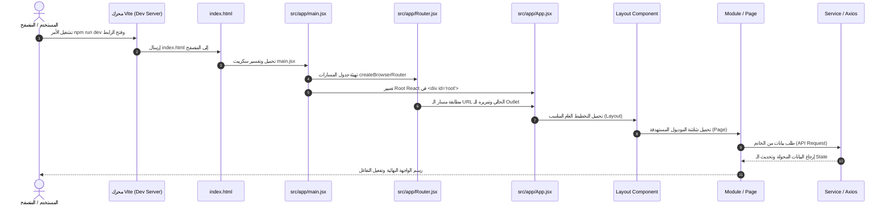
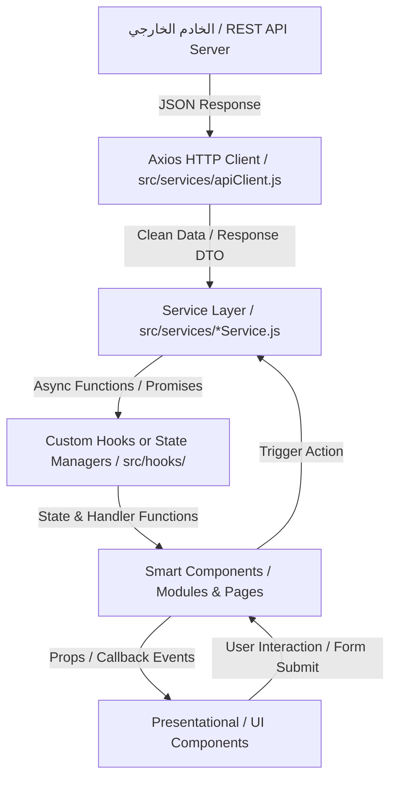

# 📘 وثيقة التوثيق المعماري الرسمي (PROJECT_DOCUMENTATION.md)
## React + Vite Enterprise Starter Template

---

> **بيان رسمي:** تُعد هذه الوثيقة المرجع المعماري والتقني الشامل لهذا الـ Template. صُمم هذا القالب ليكون نقطة انطلاق معيارية ونظيفة (Agnostic Starter Template) تناسب أي نوع من مشاريع الويب التفاعلية (SaaS, Dashboards, Portals, Web Applications) دون التقيد بمجال عمل محدد.

---

# 📑 فهرس المحتويات

1. [الجزء الأول: المقدمة والفلسفة المعمارية](#الجزء-الأول-المقدمة-والفلسفة-المعمارية)
2. [الجزء الثاني: التشريح التفصيلي للمجلدات (Folder Structure)](#الجزء-الثاني-التشريح-التفصيلي-للمجلدات-folder-structure)
3. [الجزء الثالث: التحليل العميق لملفات المشروع (Files Analysis)](#الجزء-الثالث-التحليل-العميق-لملفات-المشروع-files-analysis)
4. [الجزء الرابع: تحليل حزم الاعتماديات (Dependencies Analysis)](#الجزء-الرابع-تحليل-حزم-الاعتماديات-dependencies-analysis)
5. [الجزء الخامس: مسار دورة حياة تشغيل المشروع (Project Runtime Flow)](#الجزء-الخامس-مسار-دورة-حياة-تشغيل-المشروع-project-runtime-flow)
6. [الجزء السادس: نظام الاستيراد وإدارة المسارات (Import Flow & Path Aliasing)](#الجزء-السادس-نظام-الاستيراد-وإدارة-المسارات-import-flow--path-aliasing)
7. [الجزء السابع: مسار تدفق البيانات (Data Flow Architecture)](#الجزء-السابع-مسار-تدفق-البيانات-data-flow-architecture)
8. [الجزء الثامن: قواعد وضوابط المجلدات (Folder Rules: Do's & Don'ts)](#الجزء-الثامن-قواعد-وضوابط-المجلدات-folder-rules-dos--donts)
9. [الجزء التاسع: أفضل الممارسات المعتمدة (Best Practices)](#الجزء-التاسع-أفضل-الممارسات-المعتمدة-best-practices)
10. [الجزء العاشر: المبادئ والقوانين الصارمة للمشروع (Project Core Guidelines)](#الجزء-العاشر-المبادئ-والقوانين-الصارمة-للمشروع-project-core-guidelines)
11. [الجزء الحادي عشر: المخطط الشجري الكامل للمشروع (Project Tree)](#الجزء-الحادي-عشر-المخطط-الشجري-الكامل-للمشروع-project-tree)
12. [الجزء الثاني عشر: دليل المطور الجديد (Developer Onboarding Manual)](#الجزء-الثاني-عشر-دليل-المطور-الجديد-developer-onboarding-manual)
13. [الجزء الثالث عشر: المرجع السريع (Quick Reference Cheat Sheet)](#الجزء-الثالث-عشر-المرجع-السريع-quick-reference-cheat-sheet)
14. [الجزء الرابع عشر: التقييم المعماري الهندسي (Architecture Analysis)](#الجزء-الرابع-عشر-التقييم-المعماري-الهندسي-architecture-analysis)
15. [الجزء الخامس عشر: استراتيجيات التوسع المستقبلي (Future Expansion Blueprints)](#الجزء-الخامس-عشر-استراتيجيات-التوسع-المستقبلي-future-expansion-blueprints)

---

# الجزء الأول: المقدمة والفلسفة المعمارية

### 1.1 فكرة الـ Template
تم تصميم هذا القالب ليوفر بنية تحتية هندسية متينة لمشاريع **React 19** الحديثة المدعومة بمحرك البناء فائق السرعة **Vite 8**. الهدف الجوهري منه هو إزالة الفوضى التأسيسية التي تواجه فرق التطوير عند بدء أي مشروع جديد، وتوفير بيئة عمل معيارية تفرض نظاماً واضحاً لفصل الاهتمامات (Separation of Concerns) ونظافة الكود (Clean Code).

### 1.2 فلسفة تقسيم المشروع
تتبنى هذه المعمارية مبدأ **التركيب الطبقي الموديولي (Layered Modular Architecture)**:
1. **طبقة النواة والتجهيز (`app/`):** مسؤولة حصراً عن تهيئة التطبيق، ربط الموجهات (Routing)، وتجميع الـ Providers.
2. **طبقة المكونات المشتركة (`components/`):** توفر العناصر البصرية القابلة لإعادة الاستخدام في كل أجزاء التطبيق (Layouts, UI, Common elements).
3. **طبقة الأعمال والميزات (`modules/` & `auth/`):** تعزل شاشات ومنطق الميزات المستقلة عن باقي التطبيق لمنع التشابك.
4. **طبقة البيانات والتكامل (`services/`):** تعزل استدعاءات الخادم والـ HTTP Requests تماماً عن عناصر واجهة المستخدم.
5. **طبقة المنطق والحالة (`context/` & `hooks/`):** توفر وصولاً نظيفاً للحالات المشتركة والوظائف التفاعلية القابلة لإعادة الاستخدام.

### 1.3 قابلية التوسع المستقبلي (Scalability Vision)
تم بناء القالب بحيث لا يتطلب إعادة هيكلة جذرية عندما ينمو المشروع من 5 صفحات إلى 500 صفحة. يتيح نظام الـ Aliasing (`@/*`) ونظام الـ Modular Routing إضافة ميزات جديدة بالكامل بمجرد إنشاء مجلد فرعي وربطه في مصفوفة التوجيه.

---

# الجزء الثاني: التشريح التفصيلي للمجلدات (Folder Structure)

```
MyNewProjectReact/
├── public/
├── src/
│   ├── app/
│   ├── assets/
│   ├── auth/
│   ├── components/
│   │   └── layouts/
│   ├── context/
│   ├── hooks/
│   ├── modules/
│   └── services/
```

---

### 2.1 مجلد `src/app/`
* **الهدف والوظيفة:** يمثل "غرفة التحكم المركزية" للتطبيق. وظيفته احتواء إعدادات Bootstraping الخاصة بالتطبيق، ونقطة التوجيه (Router)، والمكون الجذري (`App.jsx`).
* **ماذا يحتوي:**
  * `main.jsx`: نقطة الدخول البرمجية وربط تطبيق React بالـ DOM الحقيقي.
  * `App.jsx`: الحاوية الرئيسية للتطبيق والمحتوية على الـ `<Outlet />` العام.
  * `Router.jsx`: جدول المسارات المركزي للتطبيق بالكامل.
* **ما لا يجب أن يوضع بداخله:**
  * يُمنع منعاً باتاً وضع مكونات UI فرعية (مثل Buttons, Modals).
  * يُمنع كتابة دوال API أو استدعاءات Axios بداخله.
  * يُمنع وضع منطق أعمال (Business Logic) خاص بصفحة معينة.
* **علاقته بباقي المشروع:** هو المستهلك النهائي لكل المجلدات؛ يستورد الصفحات من `modules/` و `auth/`، والـ Layouts من `components/layouts/` لتجميعها في الـ Router.

---

### 2.2 مجلد `src/assets/`
* **الهدف والوظيفة:** تخزين الأصول الثابتة التي تمر عبر خط معالجة **Vite Bundler** (تخضع للضغط، والـ Hash Caching، والتحسين التلقائي أثناء الـ Build).
* **ماذا يحتوي:**
  * الصور المدمجة في التصميم (SVGs, PNGs, WebP).
  * الأيقونات المحلية والخطوط (Custom Fonts: WOFF2, TTF).
  * ملفات التنسيق العامة أو المتغيرات اللونية (CSS/SCSS variables).
* **ما لا يجب أن يوضع بداخله:**
  * ملفات JavaScript أو React Components.
  * الملفات الثابتة التي يجب أن تبقى بمسارات جامدة دون تعديل أسمائها (تلك مكانها `public/`).
* **علاقته بباقي المشروع:** يُستورد من خلال المكونات والصفحات عبر المسار المختصر `@/assets/...`.

---

### 2.3 مجلد `src/auth/`
* **الهدف والوظيفة:** عزل كامل لمنظومة المصادقة، والتحقق، وإدارة جلسة المستخدم (Authentication & Session Management).
* **ماذا يحتوي:**
  * صفحات تسجيل الدخول، التسجيل، واستعادة كلمة المرور (`Login`, `Register`, `ForgotPassword`).
  * نماذج التحقق (Auth Forms) والمكونات المرئية الخاصة بالمصادقة فقط.
  * الـ Context والـ Hooks الخاصة ببيانات المستخدم الحالي والـ Tokens (`AuthContext`, `useAuth`).
* **ما لا يجب أن يوضع بداخله:**
  * صفحات التطبيق الداخلية غير المتعلقة بالمصادقة.
  * استدعاءات API لبيانات عامة خارج سياق الحساب وتسجيل الدخول.
* **علاقته بباقي المشروع:** يوفر حالة المصادقة (Auth State) والـ Token لباقي أجزاء التطبيق، وتُربط مساراته في `Router.jsx`.

---

### 2.4 مجلد `src/components/`
* **الهدف والوظيفة:** الحاوية الرئيسية لكافة مكونات واجهة المستخدم (UI Components) **المشتركة** عبر التطبيق.
* **المجلدات الفرعية الأساسية:**
  * `components/layouts/`: التخطيطات الهيكلية الرئيسية للتطبيق (مثل `MainLayout`, `AuthLayout`, `DashboardLayout`, `Navbar`, `Sidebar`, `Footer`).
  * `components/ui/` (توسعي): العناصر الأولية المعادة الاستخدام (Buttons, Inputs, Modals, Badges, Loaders).
  * `components/common/` (توسعي): المكونات المركبة المشتركة (DataTable, Pagination, ConfirmationDialog).
* **ما لا يجب أن يوضع بداخله:**
  * مكونات مخصصة تخدم ميزة واحدة فقط (Feature-specific components).
  * دوال استدعاء API أو معالجة بيانات خاصة بجدول معين في قاعدة البيانات.
* **علاقته بباقي المشروع:** تستورده كل الـ Modules والـ Pages لبناء الواجهات الرسومية، وتستورد `components/layouts/` في `Router.jsx`.

---

### 2.5 مجلد `src/context/`
* **الهدف والوظيفة:** إدارة الحالات العامة المشتركة على مستوى التطبيق ككل (Global Client State) باستخدام **React Context API**.
* **ماذا يحتوي:**
  * ملفات الـ Context والـ Providers الخاصة بالحالات العامة فقط (مثل `ThemeContext`, `LanguageContext`, `UIContext`).
* **ما لا يجب أن يوضع بداخله:**
  * الحالات المحلية الخاصة بصفحة أو استمارة واحدة (تلك تُدار داخل الـ Component عبر `useState`).
  * كاش البيانات المسترجعة من الخادم (Server State Caching) - هذا مكانه مكتبات إدارة البيانات.
* **علاقته بباقي المشروع:** يُغلف التطبيق عبر الـ Providers في `App.jsx` أو `main.jsx`، وتُستهلك قيمه عبر الـ Custom Hooks.

---

### 2.6 مجلد `src/hooks/`
* **الهدف والوظيفة:** احتواء دوال الخطافات المخصصة (**Custom Hooks**) العامة التي تعزل المنطق التفاعلي وتجعله قابلاً لإعادة الاستخدام.
* **ماذا يحتوي:**
  * خطافات عامة لا ترتبط بميزة تجارية محددة (مثل `useLocalStorage`, `useDebounce`, `useMediaQuery`, `useFetch`, `useToggle`).
* **ما لا يجب أن يوضع بداخله:**
  * مكونات JSX أو واجهات بصرية.
  * Hooks ترتبط بموديول واحد فقط ويستحيل إعادة استخدامها في مكان آخر (تلك توضع بجوار الموديول الخاص بها).
* **علاقته بباقي المشروع:** تُستدعى هذه الـ Hooks داخل المكونات والصفحات لتزويدها بقدرات وظيفية جاهزة دون تكرار الكود.

---

### 2.7 مجلد `src/modules/`
* **الهدف والوظيفة:** قلب التطبيق الوظيفي (Domain / Feature Layer). يقسم التطبيق إلى وحدات وظيفية مستقلة (Modules) بدلاً من خلط الشاشات في مجلد واحد مسطح.
* **ماذا يحتوي:**
  * شاشات التطبيق وميزاته مقسمة حسب المجال (مثال: `modules/Home/`, `modules/Users/`, `modules/Settings/`).
  * كل Module داخله يمكن أن يحتوي على صفحته الرئيسية (`Index.jsx` أو `HomePage.jsx`)، ومكوناته الخاصة به، وخطافاته الفرعية.
* **ما لا يجب أن يوضع بداخله:**
  * مكونات مشتركة عامة يحتاجها موديول آخر (يجب رفعها إلى `src/components/`).
  * إعدادات التوجيه المركزية.
* **علاقته بباقي المشروع:** تُصدر الشاشات النهائية ليتم تسجيلها في `src/app/Router.jsx`.

---

### 2.8 مجلد `src/services/`
* **الهدف والوظيفة:** طبقة عزل الاتصال بالشبكة واستدعاءات الخوادم والخدمات الخارجية (Data Access & API Layer).
* **ماذا يحتوي:**
  * إعداد الـ HTTP Client المركزي (Axios Instance, Base URL, Interceptors).
  * ملفات الخدمات البرمجية المقسمة وظيفياً (مثل `authService.js`, `userService.js`, `apiClient.js`).
* **ما لا يجب أن يوضع بداخله:**
  * كود JSX أو State أو Hooks خاصة بـ React.
  * نصوص ثابتة لواجهات المستخدم.
* **علاقته بباقي المشروع:** يتم استدعاء دوال الـ Services داخل الـ Hooks أو الـ Components لجلب البيانات وتحديثها.

---

### 2.9 مجلد `public/`
* **الهدف والوظيفة:** استضافة الأصول الثابتة العامة تماماً والتي لا تتطلب أي معالجة أو تجميع بواسطة Vite، وتُتاح مباشرة على المسار الجذري للموقع `/`.
* **ماذا يحتوي:**
  * `favicon.ico`, `robots.txt`, `manifest.json`, صور المشاركة الاجتماعية (Open Graph Images).
* **ما لا يجب أن يوضع بداخله:**
  * ملفات CSS أو JS الخاصة بكود التطبيق الداخلي.

---

# الجزء الثالث: التحليل العميق لملفات المشروع (Files Analysis)

---

### 3.1 ملف `src/app/main.jsx`
* **لماذا هو موجود:** يمثل نقطة الإقلاع البرمجية الأساسية لتطبيق React (The Entry Point).
* **متى يُستدعى:** هو أول ملف JavaScript ينفذه المتصفح فور تحميل عنصر `<script type="module" src="/src/app/main.jsx">` الموجود في `index.html`.
* **من يستخدمه:** المتصفح عبر محرك Vite.
* **ماذا يحدث بداخله:**
  1. استيراد `ReactDOM` من حزمة `react-dom/client`.
  2. استيراد موجه المسارات `RouterProvider` وجدول المسارات `router` من `Router.jsx`.
  3. استهداف العنصر الجذري `<div id="root"></div>`.
  4. إنشاء شجرة React عبر `ReactDOM.createRoot()` وتصيير المكونات بداخلها.
* **نطاق الملف:** **Global Root**.

---

### 3.2 ملف `src/app/App.jsx`
* **لماذا هو موجود:** يمثل المكون الأب الأعلى لشجرة التطبيق (Root Component).
* **متى يُستدعى:** عند تحميل التوجيه الأب، ليكون بمثابة الوعاء الحاوي للصفحات.
* **من يستخدمه:** الـ Router في `Router.jsx` كمكون رئيسي للتطبيق.
* **ماذا يحدث بداخله:** يحتوي على مكون `<Outlet />` الخاص بـ `react-router-dom` الذي يعمل كمنفذ يتم من خلاله عرض الصفحة الحالية المتطابقة مع الرابط (URL).
* **نطاق الملف:** **Global**.

---

### 3.3 ملف `src/app/Router.jsx`
* **لماذا هو موجود:** إدارة وتنظيم مسارات التطبيق (Client-Side Routing System).
* **متى يُستدعى:** فور إقلاع التطبيق داخل `main.jsx` لتحديد الشاشة المناسبة للرابط المطلوب.
* **من يستخدمه:** `RouterProvider` داخل `main.jsx`.
* **ماذا يحدث بداخله:**
  1. استيراد دالة `createBrowserRouter` من مكتبة `react-router-dom`.
  2. استيراد الشاشات والموديولات من مساراتها باستخدام الـ Alias (مثل `import Index from "@/auth"`).
  3. تعريف كائن المسارات (Path, Element, Children, ErrorElement).
* **نطاق الملف:** **Global Routing**.

---

### 3.4 ملف `vite.config.js`
* **لماذا هو موجود:** ملف الإعدادات الرسمي لمحرك البناء والتطوير **Vite**.
* **متى يُستدعى:** أثناء تشغيل بيئة التطوير `npm run dev` وأثناء بناء النسخة الإنتاجية `npm run build`.
* **من يستخدمه:** محرك Vite و Rollup الداخلي.
* **ماذا يحدث بداخله:**
  1. تفعيل الملحق الرسمي لدعم React `@vitejs/plugin-react`.
  2. ضبط الـ **Path Aliases** (مثل تحويل البادئة `@` للإشارة مباشرة لمجلد `./src`) عبر وحدة `path` الخاصة بـ Node.js.
* **نطاق الملف:** **Build-Time Config**.

---

### 3.5 ملف `package.json`
* **لماذا هو موجود:** وثيقة الهوية والبيانات الوصفية للمشروع (Project Manifest).
* **متى يُستدعى:** عند تثبيت الحزم `npm install`، وعند تشغيل الأوامر في `scripts`.
* **من يستخدمه:** مديري الحزم (NPM, Yarn, PNPM) وبيئات الـ CI/CD.
* **ماذا يحدث بداخله:** يحدد اسم المشروع، نسخته، نوع الوحدات (`"type": "module"` لدعم ES Modules)، نصوص التشغيل (`scripts`)، وقائمتي حزم التشغيل والإنتاج (`dependencies` و `devDependencies`).
* **نطاق الملف:** **Project Meta Configuration**.

---

### 3.6 ملف `eslint.config.js`
* **لماذا هو موجود:** ضبط قواعد الفحص الساكن للكود (Flat ESLint Configuration).
* **متى يُستدعى:** أثناء كتابة الكود داخل المحرر (VS Code) أو عند تشغيل الأمر `npm run lint`.
* **من يستخدمه:** محرك ESLint لضمان جودة الكود واكتشاف الأخطاء البرمجية قبل التشغيل.
* **ماذا يحدث بداخله:** تطبيق القواعد المعيارية لجافاسكريبت، وقواعد الـ React Hooks (`eslint-plugin-react-hooks`) وقواعد الـ Fast Refresh (`eslint-plugin-react-refresh`).
* **نطاق الملف:** **Development Tooling**.

---

### 3.7 ملف `index.html`
* **لماذا هو موجود:** الصفحة الوحيدة التي يستقبلها المتصفح في تطبيقات الصفحة الواحدة (SPA Container).
* **متى يُستدعى:** عند أول طلب HTTP يوجهه المستخدم للموقع.
* **من يستخدمه:** متصفح الويب كأول ملف يتم تحليله وعرضه.
* **ماذا يحدث بداخله:**
  1. تهيئة رأس الصفحة (Encoding, Viewport, Title).
  2. توفير الوعاء الحاوي `<div id="root"></div>`.
  3. استدعاء السكربت التنفيذي الأولي عبر `<script type="module" src="/src/app/main.jsx"></script>`.
* **نطاق الملف:** **HTML Root**.

---

### 3.8 ملف `.env`
* **لماذا هو موجود:** إدارة متغيرات البيئة السرية والقيم المتغيرة حسب بيئة التشغيل (Development vs Production).
* **متى يُستدعى:** يقرأه محرك Vite تلقائياً عند بدء التشغيل وتوفيره عبر `import.meta.env`.
* **من يستخدمه:** كود التطبيق لاستخراج العناوين الحساسة كـ `VITE_API_BASE_URL`.
* **ماذا يحدث بداخله:** تخزين المتغيرات على هيئة `KEY=VALUE` بشرط بدء أي متغير بـ `VITE_` لكي يسمح Vite بتمريره للعميل بأمان.
* **نطاق الملف:** **Environment Configuration**.

---

# الجزء الرابع: تحليل حزم الاعتماديات (Dependencies Analysis)

| اسم المكتبة | التصنيف | الوظيفة | لماذا تم تثبيتها؟ | متى تُستخدم؟ | البديل المتاح |
| :--- | :--- | :--- | :--- | :--- | :--- |
| **`react`** | `dependencies` (Runtime) | نواة مكتبة بناء واجهات المستخدم | البنية الأساسية للمشروع لإنشاء الـ Components والـ Virtual DOM | طوال دورة حياة التطبيق | Solid.js / Preact / Vue |
| **`react-dom`** | `dependencies` (Runtime) | طبقة الربط بين React والمتصفح | تصيير عناصر React داخل الـ DOM الحقيقي للمتصفح | في `main.jsx` لإنشاء الـ Root | `react-dom/server` (للـ SSR) |
| **`react-router-dom`** | `dependencies` (Runtime) | إدارة التوجيه والمسارات (Routing) | تمكين التنقل بين الصفحات بدون إعادة تحميل المتصفح (SPA) | في `Router.jsx` والمكونات للتنقل وحماية الروابط | TanStack Router |
| **`axios`** | `dependencies` (Runtime) | عميل HTTP لإجراء الطلبات الخارجية | يوفر Interceptors، إلغاء الطلبات، والتحويل التلقائي لـ JSON | داخل `services/` للتواصل مع الخوادم والـ REST APIs | Fetch API الأصيل / Ky |
| **`react-hook-form`** | `dependencies` (Runtime) | إدارة النماذج والتحقق من المدخلات | إدارة الاستمارات بكفاءة عالية وأقل عدد من الـ Re-renders عبر Uncontrolled Components | في شاشات تسجيل الدخول ونماذج إدخال البيانات | Formik / React 19 Actions |
| **`react-hot-toast`** | `dependencies` (Runtime) | نظام إشعارات منبثقة (Toasts) | تقديم تغذية بصرية راجعة للمستخدم عند نجاح أو فشل العمليات | عند نجاح استدعاء الـ API أو وقوع خطأ | Sonner / React-Toastify |
| **`react-icons`** | `dependencies` (Runtime) | مكتبة أيقونات شاملة | تضمين أشهر حزم الأيقونات (FontAwesome, Feather, Lucide) كـ React Components | في الأزرار، القوائم، وواجهات العرض | Lucide-React / Heroicons |
| **`aos`** | `dependencies` (Runtime) | مكتبة تحريك العناصر عند التمرير (Animate On Scroll) | إضافة لمسات جمالية تفاعلية للواجهات عند وصول المستخدم إليها | في صفحات الهبوط والتعريف | Framer Motion / CSS Animations |
| **`vite`** | `devDependencies` (Build-Time) | محرك التطوير والبناء فائق السرعة | توفير بيئة تطوير فورية (HMR) وبناء النسخة النهائية المحسنة | أثناء التطوير والـ Build | Webpack / Turbopack / Rspack |
| **`@vitejs/plugin-react`**| `devDependencies` (Build-Time) | ملحق Vite لدعم React | تمكين دعم JSX وتحديث الكود الفوري (Fast Refresh) | أثناء التطوير والترجمة | `@vitejs/plugin-react-swc` |
| **`eslint`** | `devDependencies` (Development) | أداة التدقيق الساكن للأكواد | اكتشاف الأخطاء البرمجية وضمان التزام الفريق بقواعد موحدة | أثناء التطوير والـ CI/CD | Biome / Prettier |
| **`@types/react`** | `devDependencies` (Development) | تعاريف الأنواع البرمجية لـ React | تزويد محرر الكود (VS Code) بميزة الإكمال التلقائي (IntelliSense) | أثناء كتابة الكود داخل المحرر | مدمجة في حزم TypeScript |

---

# الجزء الخامس: مسار دورة حياة تشغيل المشروع (Project Runtime Flow)



### خطوات مسار التشغيل بالتفصيل:
1. **أمر التشغيل `npm run dev`:** يشغل محرك Vite خادم التطوير المحلي فائق السرعة ويجهز الـ Module Graph عبر الـ Native ES Modules.
2. **تحميل `index.html`:** يرسل الخادم صفحة HTML الأولية التي تحتوي على `<div id="root"></div>` وسطر استدعاء السكربت الموديولي `/src/app/main.jsx`.
3. **تنفيذ `src/app/main.jsx`:** يقوم المتصفح بتحميل وتفسير `main.jsx` الذي ينشئ الـ React Virtual DOM Root عبر `ReactDOM.createRoot`.
4. **تفعيل الـ Router:** يمرر كائن `router` المعرف في `Router.jsx` إلى مزود التوجيه `<RouterProvider router={router} />`.
5. **مطابقة المسار وتحميل المكونات:** يحلل الراوتر عنوان الرابط المطلوب (مثلاً `/`) ويقوم بتصيير المكون المرتبط به (المعين في المسار).
6. **الـ Layout والـ Outlet:** يتم تصيير الهيكل العام (مثل الـ Navbar والـ Sidebar) ويتم تمرير محتوى الصفحة عبر المكون `<Outlet />`.
7. **طلب البيانات عبر الـ Services:** تقوم الصفحة أو المكون الفرعي بطلب البيانات عبر طبقة الـ `services` المعزولة مستخدمة مكتبة `axios`.
8. **الرسم النهائي والتحديث:** بعد وصول البيانات يتم تحديث حالة المكون (State)، وتنعكس التغييرات فوراً وبدقة على شاشة المستخدم النهائي.

---

# الجزء السادس: نظام الاستيراد وإدارة المسارات (Import Flow & Path Aliasing)

### 6.1 المسار المختصر الأساسي (`@/*`)
تم تكوين الـ Alias `@` داخل [vite.config.js](file:///d:/project/Novexa/MyNewProjectReact/vite.config.js) ليشير مباشرة إلى مجلد `src/`:

```javascript
resolve: {
  alias: {
    "@": path.resolve(__dirname, "./src"),
  },
}
```

### 6.2 متى نستخدم كل نوع من الـ Imports؟

1. **الـ Path Alias (`@/...`) — [الخيار الإجباري للتنقل بين الطبقات]:**
   * يُستخدم عند استيراد أي ملف يقع في طبقة أخرى مختلفة عن مكان الملف الحالي.
   * **مثال صحيح:**
     ```javascript
     import { Button } from "@/components/ui/Button";
     import { authService } from "@/services/authService";
     import { useAuth } from "@/hooks/useAuth";
     ```
2. **الـ Relative Import (`./...`) — [مسموح حصراً داخل نفس المجلد]:**
   * يُستخدم فقط عندما يكون الملف المستورد جاراً ملاصقاً في نفس المجلد الفرعي (Sibling or Direct Child).
   * **مثال صحيح:**
     ```javascript
     import { LoginForm } from "./LoginForm"; // كلاهما داخل src/auth
     import styles from "./Button.module.css";
     ```
3. **تجنب المسارات النسبية المتعددة العميقة (`../../..`):**
   * يُمنع منعاً باتاً كتابة مسارات متداخلة مثل `import Button from "../../../components/Button"`؛ لأنها هشة وتتكسر عند نقل الملفات.

---

# الجزء السابع: مسار تدفق البيانات (Data Flow Architecture)

يعتمد هذا الـ Template نمط **تدفق البيانات أحادي الاتجاه (Unidirectional Data Flow)** مع عزل صارم لكل مرحلة:



### تفصيل طبقات تدفق البيانات:
1. **طبقة الشبكة (Network Layer):** مثيل Axios المركزي في `services/` يقوم بإرسال الـ Headers وتضمين الـ Bearer Token تلقائياً، ويعالج أخطاء الشبكة الشائعة (مثل 401 Unauthorized).
2. **طبقة الخدمات (Service Layer):** دوال جافاسكريبت نقية تستقبل البارامترات وتستدعي الـ Endpoints وتعيد البيانات المفيدة فقط (Pure Data Payload).
3. **طبقة الحالة (State/Hook Layer):** تستهلك الـ Service وتدير حالات الـ Loading والـ Error والـ Data باستخدام `useState` أو `useReducer`.
4. **طبقة العرض (UI Layer):** مكونات واجهة مستخدم نقية (Stateless / Dumb Components) تستقبل البيانات عبر الـ Props وتعرضها، وتمرر أحداث المستخدم (Events) إلى المكون الأب.

---

# الجزء الثامن: قواعد وضوابط المجلدات (Folder Rules: Do's & Don'ts)

---

### 8.1 مجلد `src/app/`
* ✅ **يُسمح بـ:** وضع ملفات التكوين والتهيئة العامة للتطبيق (`main.jsx`, `App.jsx`, `Router.jsx`, `providers.jsx`).
* ❌ **لا يُسمح بـ:** وضع مكونات واجهة، أو نصوص CSS خاصة بصفحة معينة، أو استدعاءات API.
* 📌 **مثال صحيح:** `src/app/Router.jsx` يحتوي على مصفوفة المسارات.
* 🚫 **مثال خاطئ:** `src/app/UserCard.jsx` (مكانه الصحيح `src/components/` أو داخل موديول الـ Users).

---

### 8.2 مجلد `src/components/`
* ✅ **يُسمح بـ:** وضع المكونات المشتركة العامة، والتخطيطات الهيكلية (`layouts/`)، ومكونات الـ UI الأولية (`Button`, `Modal`).
* ❌ **لا يُسمح بـ:** وضع مكون خاص بموديول واحد فقط، أو ربطه مباشرة بـ Service محددة خاصة بكيان معين.
* 📌 **مثال صحيح:** `src/components/layouts/MainLayout.jsx` أو `src/components/ui/Button.jsx`.
* 🚫 **مثال خاطئ:** `src/components/UserBillingTable.jsx` (مكانه الصحيح داخل `src/modules/Billing/`).

---

### 8.3 مجلد `src/modules/`
* ✅ **يُسمح بـ:** إنشاء مجلد لكل ميزة وظيفية (Feature Folder) يحتوي على شاشاتها ومكوناتها الخاصة بها فقط.
* ❌ **لا يُسمح بـ:** وضع مكونات أو دوال عامة يحتاجها أكثر من موديول آخر.
* 📌 **مثال صحيح:** `src/modules/Home/Index.jsx` ومعه `src/modules/Home/components/HeroSection.jsx`.
* 🚫 **مثال خاطئ:** وضع زر عام `modules/Home/Button.jsx` ثم استيراده من داخل موديول الـ Settings.

---

### 8.4 مجلد `src/services/`
* ✅ **يُسمح بـ:** دوال Async للتواصل مع الـ API والخدمات الخارجية فقط.
* ❌ **لا يُسمح بـ:** وضع كود JSX، أو React Hooks (`useState`, `useEffect`)، أو ستايلات.
* 📌 **مثال صحيح:**
  ```javascript
  // src/services/userService.js
  export const getUserProfile = async (id) => { ... }
  ```
* 🚫 **مثال خاطئ:**
  ```javascript
  // لا تضع Hooks داخل الـ Services
  export const useUserProfile = () => { const [user, setUser] = useState(); ... }
  ```

---

# الجزء التاسع: أفضل الممارسات المعتمدة (Best Practices)

### 9.1 اصطلاحات التسمية (Naming Conventions)
1. **مكونات React والـ Layouts:** دائماً بصيغة **PascalCase** (مثل `App.jsx`, `MainLayout.jsx`, `Index.jsx`).
2. **الـ Hooks:** دائماً بصيغة **camelCase** وتبدأ بكلمة `use` (مثل `useAuth.js`, `useDebounce.js`).
3. **ملفات الخدمات والـ Utils والتكوينات:** بصيغة **camelCase** (مثل `authService.js`, `formatters.js`, `apiClient.js`).
4. **المجلدات الهيكلية:** تُسمى بصيغة الجمع والأحرف الصغيرة (مثل `components`, `services`, `hooks`, `context`).

### 9.2 كتابة المكونات (Component Design)
* **المسؤولية الأحادية (Single Responsibility):** يجب أن يؤدي المكون غرضاً واحداً واضحاً.
* **فصل الحسابات عن العرض:** تجنب كتابة عمليات حسابية معقدة أو عمليات معالجة نصوص طويلة داخل الـ JSX؛ انقلها إلى دوال مساعدة في `utils/` أو داخل Custom Hook.
* **استخدام الـ Props بحكمة:** تجنب تمرير الـ Props عبر مستويات عميقة (Props Drilling) واستعن بـ Context أو المكونات المركبة (Composition).

---

# الجزء العاشر: المبادئ والقوانين الصارمة للمشروع (Project Core Guidelines)

> [!IMPORTANT]
> **قوانين معمارية ملزمة لكافة المطورين العاملين على هذا المشروع:**

1. ⛔ **حظر الـ Direct Axios Calls:** يُمنع منعاً باتاً استدعاء مكتبة `axios` مباشرة من داخل أي Component. أي طلب شبكة يجب أن يمر حتماً عبر طبقة `src/services/`.
2. ⛔ **حظر الـ Direct DOM Manipulation:** يُمنع استخدام `document.getElementById` أو jQuery للتعديل على عناصر الصفحة، ويجب الاعتماد كلياً على الـ React State والـ Refs.
3. ⛔ **حظر الـ Relative Imports الطويلة:** يُمنع استيراد أي ملف خارجي بمسار يتجاوز خطوة واحدة (`../../..`)؛ استخدم دائماً الـ Path Alias `@/...`.
4. ⛔ **حظر الـ Logic داخل الـ Layouts:** مجلد `src/components/layouts/` مخصص للهياكل التخطيطية فقط (Nav, Sidebar, Outlet) ولا يجب أن يحتوي على منطق أعمال خاص بالصفحات.
5. ⛔ **حظر الـ Inline Styles العشوائية:** تجنب استخدام `style={{...}}` للعناصر، واعتمد على فئات التنسيق المنظمة لضمان سهولة التعديل والصيانة.

---

# الجزء الحادي عشر: المخطط الشجري الكامل للمشروع (Project Tree)

```text
d:/project/Novexa/MyNewProjectReact/
│
├── .env                                # ملف المتغيرات البيئية السرية وإعدادات الـ API
├── eslint.config.js                    # ملف ضبط قواعد الفحص الساكن للكود بجافاسكريبت ورياكت
├── index.html                          # صفحة الـ SPA الأحادية الحاوية لعنصر الـ Root
├── package.json                        # سجل حزم المشروع والاعتماديات ونصوص التشغيل
├── vite.config.js                      # ملف إعدادات محرك البناء Vite وتكوين الـ Path Aliases
│
├── public/                             # الأصول الثابتة غير المعالجة من قبل Vite
│   ├── images/                         # الصور الثابتة العامة والمستقلة
│   ├── js/                             # مكتبات JavaScript ثابتة غير مجمعة
│   └── style/                          # ملفات CSS ثابتة مسبقة التحضير
│
└── src/                                # كود المصدر البرمجي للتطبيق
    ├── app/                            # غرفة التحكم المركزية للتطبيق
    │   ├── App.jsx                     # المكون الجذري الحاوي لمنفذ التوجيه Outlet
    │   ├── Router.jsx                  # جدول تعريف ومطابقة المسارات والشاشات
    │   └── main.jsx                    # نقطة الانطلاق البرمجية وربط React بالـ DOM
    │
    ├── assets/                         # الأصول المعالجة والمحسنة عبر مجمع Vite
    ├── auth/                           # وحدة إدارة المصادقة والتحقق وشاشات الدخول
    │   └── index.jsx                   # الشاشة الرئيسية لمدخل وحدة المصادقة
    │
    ├── components/                     # المكونات المشتركة عبر التطبيق ككل
    │   └── layouts/                    # التخطيطات الهيكلية الرئيسية للشاشات
    │
    ├── context/                        # سياقات إدارة الحالات العامة لتطبيق React
    ├── hooks/                          # خطافات React المخصصة والقابلة لإعادة الاستخدام
    ├── modules/                        # الميزات الوظيفية وشاشات الأعمال المقسمة
    └── services/                       # طبقة عزل الاتصال بالخوادم والـ HTTP APIs
```

---

# الجزء الثاني عشر: دليل المطور الجديد (Developer Onboarding Manual)

إذا كنت مطوراً جديداً تنضم لهذا المشروع، فهذا الدليل السريع يوضح لك خطوة بخطوة كيفية إنجاز المهام اليومية دون كسر معمارية التطبيق:

### 12.1 إعداد بيئة العمل والتشغيل
```bash
# 1. استنساخ المستودع وتثبيت الحزم
npm install

# 2. تشغيل بيئة التطوير المحلية
npm run dev

# 3. فحص الأكواد والتأكد من عدم وجود أخطاء لغوية
npm run lint
```

---

### 12.2 كيف تضيف صفحة / ميزة جديدة (Module)؟
1. افتح مجلد `src/modules/` وأنشئ مجلداً جديداً باسم الميزة (مثلاً `src/modules/Profile/`).
2. أنشئ ملف الصفحة الأساسية `Index.jsx` بداخله:
   ```jsx
   // src/modules/Profile/Index.jsx
   import React from "react";

   function ProfilePage() {
     return (
       <div className="profile-container">
         <h1>ملف المستخدم الشخصي</h1>
       </div>
     );
   }

   export default ProfilePage;
   ```
3. افتح [src/app/Router.jsx](file:///d:/project/Novexa/MyNewProjectReact/src/app/Router.jsx) وسجل المسار الجديد باستخدام الـ Alias:
   ```jsx
   import ProfilePage from "@/modules/Profile/Index";

   export const router = createBrowserRouter([
     // ... المسارات الحالية
     {
       path: "/profile",
       element: <ProfilePage />,
     },
   ]);
   ```

---

### 12.3 كيف تنشئ خدمة API جديدة (Service)؟
1. افتح مجلد `src/services/` وأنشئ ملف الخدمة (مثلاً `productService.js`).
2. اكتب دوال الاتصال مستخدماً مكتبة `axios` دون أي كود JSX:
   ```javascript
   // src/services/productService.js
   import axios from "axios";

   const BASE_URL = import.meta.env.VITE_API_BASE_URL || "https://api.example.com";

   export const getProducts = async () => {
     const response = await axios.get(`${BASE_URL}/products`);
     return response.data;
   };
   ```

---

### 12.4 كيف تنشئ واستخدم Custom Hook؟
1. افتح مجلد `src/hooks/` وأنشئ الملف (مثلاً `useToggle.js`).
2. اكتب المنطق وأعد القيم والدوال:
   ```javascript
   // src/hooks/useToggle.js
   import { useState, useCallback } from "react";

   export const useToggle = (initialState = false) => {
     const [state, setState] = useState(initialState);
     const toggle = useCallback(() => setState((prev) => !prev), []);
     return [state, toggle];
   };
   ```
3. استورده في أي صفحة عبر: `import { useToggle } from "@/hooks/useToggle";`.

---

# الجزء الثالث عشر: المرجع السريع (Quick Reference Cheat Sheet)

| المجلد | الوظيفة الأساسية | متى أستخدمه؟ | مثال على محتواه |
| :--- | :--- | :--- | :--- |
| **`@/app`** | التكوين المركزي والـ Routing | عند تعديل مسار أو ربط مزود عام | `Router.jsx`, `App.jsx`, `main.jsx` |
| **`@/assets`** | الأصول والصور المعالجة | عند إضافة صور تصميم، أيقونات، أو خطوط | `@/assets/images/logo.svg` |
| **`@/auth`** | منظومة المصادقة والمستخدم | عند العمل على تسجيل الدخول أو الصلاحيات | `LoginForm.jsx`, `useAuth.js` |
| **`@/components`** | المكونات المشتركة والـ Layouts | عند بناء عنصر تصميم يتكرر في عدة شاشات | `MainLayout.jsx`, `Button.jsx` |
| **`@/context`** | الحالات العامة (Global State) | عند مشاركة حالة عامة (مثل الـ Theme) | `ThemeContext.jsx` |
| **`@/hooks`** | دوال التفاعل المشتركة | عند عزل منطق قابل للتكرار بين المكونات | `useDebounce.js`, `useLocalStorage.js` |
| **`@/modules`** | ميزات وشاشات التطبيق | عند إضافة صفحة جديدة أو ميزة أعمال | `src/modules/Home/Index.jsx` |
| **`@/services`** | الاتصال بالشبكة والـ APIs | عند إرسال أو استقبال بيانات من الخادم | `userService.js`, `apiClient.js` |

---

# الجزء الرابع عشر: التقييم المعماري الهندسي (Architecture Analysis)

| المعيار الهندسي | الدرجة | التحليل والتقييم الموضوعي |
| :--- | :---: | :--- |
| **Scalability (قابلية التوسع)** | **8.5 / 10** | **ممتاز:** تقسيم الميزات عبر `modules/` والـ `services/` يمنع تضخم المشروع ويسمح لعدة فرق عمل ببناء شاشات مستقلة دون حدوث صراعات كود (Git Conflicts). |
| **Maintainability (سهولة الصيانة)** | **9.0 / 10** | **استثنائي:** تحديد المسؤوليات لكل مجلد يسهل تحديد مكان أي عطل وإصلاحه بسرعة (أعطال الـ API في `services`، والتوجيه في `app`، والواجهات في `components/modules`). |
| **Readability (وضوح وقراءة الكود)** | **9.5 / 10** | **مثالي:** بفضل اعتماد الـ Path Aliases (`@/`) وتجنب المسارات النسبية الطويلة، تصبح الاستيرادات نظيفة وبديهية لأي مراجع كود. |
| **Reusability (إعادة الاستخدام)** | **8.5 / 10** | **قوي جداً:** فصل `components/layouts` و `hooks/` يضمن عدم تكرار الكود البرمجي والاعتماد على مكونات نقية. |
| **Performance (الأداء والسرعة)** | **9.0 / 10** | **فائق السرعة:** اعتماد محرك Vite 8 وبنية ES Modules يوفر سرعة إقلاع وتحديث لحظي (HMR)، مع إمكانية تفعيل الـ Code Splitting والـ Lazy Loading بسهولة. |
| **Clean Architecture (المعمارية النظيفة)** | **8.5 / 10** | **متماسك:** عزل طبقة الوصول للبيانات (`services/`) عن طبقة العرض والـ JSX يطبق مبدأ الـ Inversion of Control ويوفر استقلالية تامة للواجهات. |

---

# الجزء الخامس عشر: استراتيجيات التوسع المستقبلي (Future Expansion Blueprints)

يوضح هذا القسم كيفية دمج التقنيات المتقدمة في المستقبل **دون كسر أو تغيير الهيكل الحالي للـ Template**:

---

### 15.1 إضافة مكتبات إدارة الحالة (Zustand أو Redux Toolkit)
* **المكان المعتمد:** يتم إنشاء مجلد جديد `src/store/`.
* **الهيكل الداخلي:**
  ```text
  src/store/
  ├── index.js                  # إعداد الـ Store المركزي
  └── slices/ (أو stores/)
      ├── authSlice.js          # شريحة بيانات التوثيق
      └── uiSlice.js            # شريحة الحالات المرئية العامة
  ```
* **طريقة التكامل:** يتم استيراد الـ Hooks الخاصة بالـ Store مباشرة في المكونات عبر `@/store/...`.

---

### 15.2 إضافة TanStack React Query (Server State Caching)
* **الهدف:** إدارة كاش الخادم، وإعادة المحاولة التلقائية (Retries)، وإلغاء الطلبات المتكررة.
* **المكان المعتمد:**
  1. إعداد الـ `QueryClient` داخل `src/lib/queryClient.js`.
  2. تغليف التطبيق بـ `<QueryClientProvider>` داخل `src/app/main.jsx`.
  3. استهلاك الـ Services الحالية في `src/services/` كـ `queryFn` داخل Custom Hooks.

---

### 15.3 إضافة دعم تعدد اللغات (i18n Localization)
* **المكان المعتمد:** يتم إنشاء مجلد `src/locales/` و `src/lib/i18n.js`:
  ```text
  src/locales/
  ├── ar/                       # ملفات الترجمة العربية (JSON)
  │   ├── common.json
  │   └── auth.json
  └── en/                       # ملفات الترجمة الإنجليزية (JSON)
      ├── common.json
      └── auth.json
  ```
* **طريقة التكامل:** يتم استدعاء ملف `src/lib/i18n.js` في بداية `src/app/main.jsx` مرة واحدة فقط.

---

### 15.4 إضافة حماية المسارات والصلاحيات (Protected Routes & RBAC)
* **المكان المعتمد:** يتم إنشاء مكون الحماية في `src/components/layouts/ProtectedRoute.jsx` أو `src/routes/`:
  ```jsx
  // src/components/layouts/ProtectedRoute.jsx
  import { Navigate, Outlet } from "react-router-dom";

  export const ProtectedRoute = ({ isAllowed, redirectPath = "/login" }) => {
    if (!isAllowed) {
      return <Navigate to={redirectPath} replace />;
    }
    return <Outlet />;
  };
  ```
* **تطبيقه في `Router.jsx`:** يتم تغليف المسارات المحمية كـ Children لهذا المكون بسهولة تامة.

---

> **نهاية وثيقة التوثيق الرسمي**
> *تمت المراجعة والاعتماد وفق أحدث المعايير الهندسية لتطوير تطبيقات الويب المعاصرة (React 19 + Vite).*
